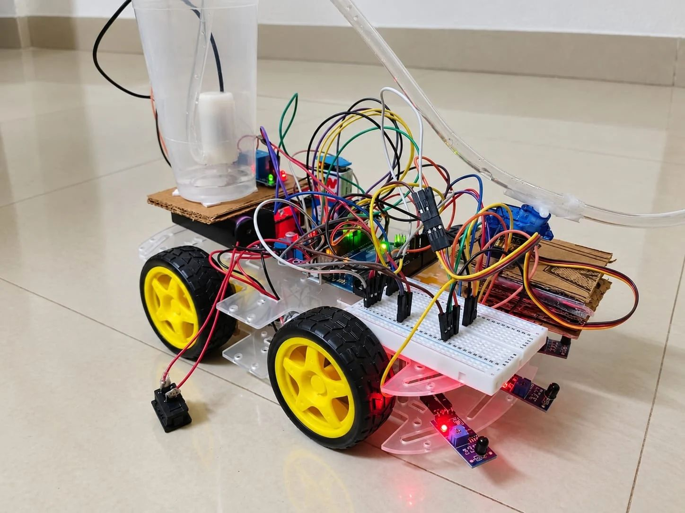
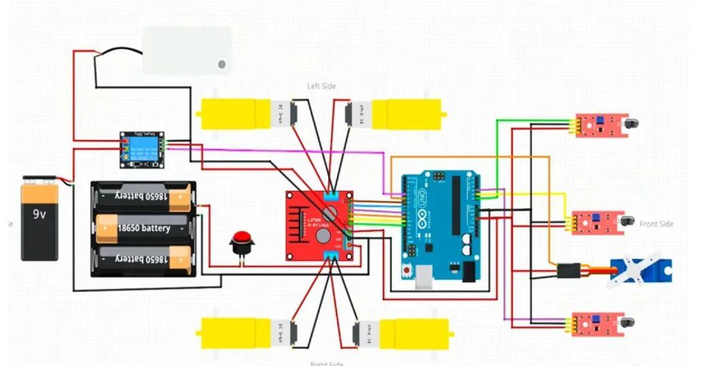

# 🔥 Arduino Autonomous Firefighting Robot

A beginner-built robot that detects a flame, drives toward it, aims, and sprays water.
This is my **first hardware project**, made to learn how sensing, decision-making, and reliability work in real robots.

> ⚠️ Learning prototype. Not a fire-safety device. Always test under supervision.



## 🎯 What it does

**Detect → Approach → Aim → Extinguish**

- 3 flame sensors (left, front, right) detect a flame and estimate its direction
- Arduino Uno + L298N motor driver steer the robot toward it
- A relay-controlled water pump starts spraying
- A servo sweeps the nozzle to aim the water

## 📌 Project status

| Version | Status | What's in it |
|---------|--------|--------------|
| **V1** | ✅ Built | Flame detection, movement, pump, servo aiming |
| **V2** | 🧪 Built, in testing | Adds MQ-2 smoke sensor, HC-SR04 ultrasonic sensor, buzzer alerts |

This README covers **Version 1**. The Version 2 circuit diagram and notes will be added soon.

## 🧰 Components (Version 1)

| Part | Quantity |
|------|----------|
| Arduino Uno | 1 |
| L298N motor driver | 1 |
| Flame sensor modules (left, front, right) | 3 |
| DC gear motors + wheels | 4 |
| 5V relay module | 1 |
| Small water pump | 1 |
| Servo motor (nozzle aiming) | 1 |
| 18650 battery pack (3 cells) | 1 |
| 9V battery | 1 |
| Push button / switch | 1 |
| Jumper wires, chassis, water container, tubing | - |

## 🔌 Circuit and wiring



### Arduino Uno connections

| Component | Pin | Arduino pin |
|-----------|-----|-------------|
| Left flame sensor | OUT | A0 |
| Centre flame sensor | OUT | A1 |
| Right flame sensor | OUT | A2 |
| Servo motor | Signal | D5 |
| Relay module | IN | D4 |

### L298N motor driver

| L298N pin | Arduino pin |
|-----------|-------------|
| IN1 | D10 |
| IN2 | D9 |
| IN3 | D8 |
| IN4 | D7 |
| ENA | D11 |
| ENB | D6 |

**Motor connections**
- OUT1 and OUT2 → left-side motors
- OUT3 and OUT4 → right-side motors

### Power and remaining connections

| Component | Connection |
|-----------|------------|
| Flame sensors VCC | Regulated 5V |
| Flame sensors GND | Common GND |
| Servo VCC | Regulated 5V supply |
| Servo GND | Common GND |
| Relay VCC | 5V |
| Relay GND | Common GND |
| Pump | Relay switching contacts + suitable pump supply |
| L298N motor supply | Battery supply |
| Arduino GND | Common GND |

> Keep all grounds common (Arduino, motor driver, relay, servo, sensors, batteries).

## 💻 Code

The Version 1 code is in [`version-1-basic/`](version-1-basic/).

1. Install the [Arduino IDE](https://www.arduino.cc/en/software)
2. Open `firefighter_v1.ino`
3. Select **Board: Arduino Uno** and your COM port
4. Click **Upload**

The Servo library comes with the Arduino IDE, so there's nothing extra to install.

## 🧪 Testing (do this safely)

1. Test with the **wheels lifted off the ground** first, and check that each motor spins the right way
2. Check each flame sensor one at a time
3. Test the pump and servo without the robot moving
4. Only then try a **small candle flame**, with water nearby and someone supervising

## ⚠️ Known limitations

- Flame sensors only give a digital "IR detected" signal. They don't measure distance, and **sunlight or bright lamps can trigger them**
- No obstacle detection in Version 1
- Wiring is on a breadboard with jumper wires, so connections can come loose
- Prototype only, not tested for real fire safety

## 🚀 Roadmap

- ✅ **Version 1:** flame detection, movement, pump, servo aiming
- 🧪 **Version 2:** MQ-2 smoke sensor, HC-SR04 ultrasonic sensor, buzzer alerts (testing)
- 🔜 Cleaner wiring, better fire-source localisation, multi-sensor data fusion, smarter autonomous navigation

## 📁 Repository structure

```
fire-fighting-robot/
├── README.md
├── LICENSE
├── robot.jpg
├── circuit.jpg
└── version-1-basic/
    └── firefighter_v1.ino
```

## 📄 License

Released under the [MIT License](LICENSE).

---
*Built while learning. Build. Test. Break. Improve. Repeat.* 🔁
